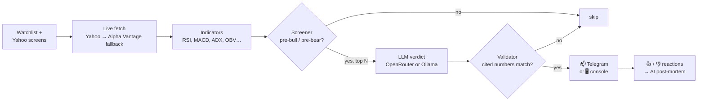

# 📈 stock-finder

[](https://github.com/liko28s/stock-finder/actions/workflows/tests.yml)

-8A2BE2)


**An AI-checked stock screener that tells you *why*.** It scans your watchlist plus Yahoo's most-active movers,
flags stocks that look like they're about to turn (**pre-bull** / **pre-bear**), asks an LLM to argue the case
using only the fetched numbers, rejects any answer that invents data, and sends you the survivors on Telegram
or prints them in your terminal.

> ⚠️ **Advisory only.** stock-finder never connects to a broker and never places a trade. It's a second opinion,
> not financial advice.

```text
🟢 #NVDA #pre_bull
PRE-BULL · confidence 72%

RSI 28.6 is oversold on 2.1x average volume; MACD histogram turned up (0.42) and zscore20 -2.3 says price is
stretched below its 20d mean, while ADX 27.9 with minus_di 31.2 still shows a live downtrend, so size small.

Data: yahoo · AI: google/gemma-4-31b-it:free. Advisory only, not a trade order.

💵 10 USD sample trade (long), worst / expected / best:
1w  -0.91 / +0.12 / +1.05
4w  -1.81 / +0.30 / +2.10
6m  -4.55 / +0.50 / +5.27
Simulated, not a forecast.

🕒 Alerted 2026-10-23 10:30 CDT @ 131.42
🔗 TradingView: https://www.tradingview.com/chart/?symbol=NVDA
```
<sub>Sample alert (illustrative numbers, trimmed).</sub>

---

## Contents

- [How it works](#how-it-works)
- [Quick start](#quick-start)
- [Console mode (no Telegram)](#console-mode-no-telegram)
- [Indicators explained](#indicators-explained)
- [Customising the AI prompts](#customising-the-ai-prompts)
- [Security & privacy](#security--privacy)
- [Running on a schedule](#running-on-a-schedule)
- [Alerts, feedback & post-mortems](#alerts-feedback--post-mortems)
- [Configuration reference](#configuration-reference)
- [Development](#development)

## How it works



1. **Discover**: your `universe.tickers` plus Yahoo predefined screens (`most_actives`, `day_gainers`, `day_losers`).
2. **Fetch live**: every ticker is fetched fresh each run (Yahoo first, Alpha Vantage as fallback). Data older than
   `ttl_seconds` is dropped, never reused.
3. **Screen**: a cheap deterministic filter needs **volume confirmation** plus either an RSI extreme, a fresh
   SMA20/SMA50 cross, or a large 1-day move. Only the top `max_picks` by relevance go on to the AI.
4. **Ask the AI**: the model gets the numbers and must return strict JSON: signal, confidence, reasoning and
   `cited_metrics`.
5. **Validate**: every cited metric must match the fetched value (±1%) and the reasoning must quote at least one.
   Hallucinated numbers mean no alert. The AI must also agree with the screener's direction.
6. **Notify** once per ticker per day, with a sample-trade table, a candlestick chart and a TradingView link.
7. **Learn**: react 👍/👎 and the next scan runs an AI post-mortem on the call.

## Quick start

```bash
git clone https://github.com/liko28s/stock-finder.git && cd stock-finder
python3 -m venv .venv && .venv/bin/pip install -e .
cp .env.example .env          # fill in the keys you have (see below)
.venv/bin/python -m stockfinder.run
```

<details>
<summary><b>Prefer <a href="https://docs.astral.sh/uv/">uv</a>?</b></summary>

No manual venv needed: `uv run` creates `.venv` and installs dependencies on first use.

```bash
git clone https://github.com/liko28s/stock-finder.git && cd stock-finder
cp .env.example .env
uv run python -m stockfinder.run              # add --console / --debug as usual
uv run python -m stockfinder.feedback         # hit rate
uv run --extra dev pytest -q                  # tests
```

In cron, call uv by absolute path (cron's `PATH` is minimal; find it with `which uv`):

```cron
*/30 8-15 * * 1-5  cd /path/to/stock-finder && $HOME/.local/bin/uv run python -m stockfinder.run >> scan.log 2>&1
```

Everywhere else in this README, `.venv/bin/python` can be swapped for `uv run python`.
</details>

| Variable | Needed? | What for |
|---|---|---|
| `OPENROUTER_API_KEY` | when `ai.backend = "openrouter"` | LLM calls ([free models](https://openrouter.ai/models?max_price=0) work) |
| `TELEGRAM_BOT_TOKEN` + `TELEGRAM_CHAT_ID` | optional | Telegram delivery. **Without them, alerts print to the console.** |
| `ALPHAVANTAGE_API_KEY` | optional | fallback data source when Yahoo fails |

No API keys at all? Set `ai.backend = "ollama"`, run a local model, and leave Telegram unset: the whole pipeline
runs locally except for the public market data fetch (and the optional chart).

## Console mode (no Telegram)

If `TELEGRAM_BOT_TOKEN` or `TELEGRAM_CHAT_ID` is missing, stock-finder prints alerts to stdout instead of sending
them. You can also force it:

```bash
.venv/bin/python -m stockfinder.run --console           # alerts in the terminal
.venv/bin/python -m stockfinder.run --console --debug   # + every rejected pick and per-model AI stats
.venv/bin/python -m stockfinder.run --console 2>/dev/null   # alerts only, logs hidden (logs go to stderr)
```

Console alerts use the same format and the same safety checks as Telegram (an alert without a pre-bull/pre-bear
signal and reasoning is refused). The 👍/👎 feedback loop and post-mortems need Telegram reactions, so they're
skipped in console mode.

## Indicators explained

Everything is computed in plain Python from **daily OHLCV** (no TA library), in `stockfinder/data.py`. If the
source returns too little history, that indicator is left out, never faked.

### Used by the screener (deterministic gate)

| Indicator | What it measures | How it's used |
|---|---|---|
| **RSI 14** (Wilder) | Momentum oscillator 0–100: speed of recent gains vs losses | ≤ `rsi_oversold` (30) → pre-bull; ≥ `rsi_overbought` (70) → pre-bear |
| **SMA 20 / SMA 50** | Short vs medium-term average price | Fresh **golden cross** (20 crosses above 50) → pre-bull; **death cross** → pre-bear |
| **Volume ratio** | Today's volume ÷ average of the prior 20 days | Must be ≥ `volume_ratio` (1.5×). No volume, no signal |
| **1-day return** | Today's % change | \|move\| ≥ `move_pct` (5%) on high volume → *momentum* pick (only when no RSI/MA signal fires) |

Picks are ranked by **relevance = volume ratio × max(|1-day move %|, |RSI − 50| / 4)**, so a quiet RSI-31 drift
loses to a 3× volume capitulation.

### Given to the AI as evidence

| Indicator | Reads as |
|---|---|
| **MACD 12/26/9** (`macd`, `macd_signal`, `macd_hist`) | Trend momentum; histogram turning positive = bullish momentum building |
| **ATR 14** (`atr`, `atr_pct`) | Average daily range, in $ and as % of price: how much the stock normally moves |
| **ADX 14** + **+DI / −DI** | Trend *strength* (> 25 = trending) and which side is pushing |
| **OBV slope 20** (`obv_slope20`, −1…1) | On-balance-volume flow: is volume backing up-days or down-days? |
| **Kaufman efficiency ratio 10** (`ker10`, 0…1) | 1 = clean straight-line trend, 0 = choppy noise |
| **Z-score 20** (`zscore20`) | Distance from the 20-day mean in standard deviations; \|z\| > 2 = stretched, mean-reversion risk |
| **Returns** (`ret1d`, `ret5d`, `ret20d`) | % change over 1 / 5 / 20 trading days |
| **Volatility 20** (`vol20`) | Daily % standard deviation; sets the bands for the sample-trade table |
| **Fundamentals** | P/E, EPS growth, revenue growth, net margin, beta, 52-week high/low (from Yahoo) |

### Sample-trade scenarios

Each alert includes a **10 USD sample trade** (long for pre-bull, short for pre-bear) with worst / expected / best
P&L after 1w, 2w, 3w, 4w, 2m and 6m. The AI writes the table, but it's given the one-sigma P&L per horizon
(`10 × vol20 × √days`). The validator **drops** any table that is unordered, goes past 3σ, or loses more than the
stake on a long. A dropped table never blocks the alert. It shows a plausible range, not a forecast.

## Customising the AI prompts

Prompts are **Markdown files, not Python strings**. Edit them and the next run uses them, no code changes:

| File | Used for |
|---|---|
| [`stockfinder/prompts/analysis.md`](stockfinder/prompts/analysis.md) | The main verdict: is this pre-bull/pre-bear setup real? |
| [`stockfinder/prompts/scenarios.md`](stockfinder/prompts/scenarios.md) | Appended to the analysis when volatility is known: the sample-trade table |
| [`stockfinder/prompts/postmortem.md`](stockfinder/prompts/postmortem.md) | Reviewing an alert after you react 👍/👎 |

Rules of the template (Python [`str.format`](https://docs.python.org/3/library/string.html#formatstrings)):

- `{placeholders}` are filled in by the code. Keep the ones the file already uses (e.g. `{ticker}`, `{signal}`,
  `{data}`, `{vol:.2f}`). You can move, drop or reword the text around them.
- Literal braces must be **doubled**: `{{"rsi": 27.4}}` reaches the model as `{"rsi": 27.4}`.
- **Keep the JSON reply contract** (`signal`, `confidence`, `reasoning`, `cited_metrics`, and for post-mortems
  `assessment`, `what_happened`, `adjustments`). The parser and validator reject anything else, by design.

Ideas: make the analyst more conservative, ask it to weigh fundamentals more, or translate the reasoning into your
language. Run `pytest` afterwards; the tests check that the prompts still render.

## Security & privacy

stock-finder was built so that a leaked log, a curious AI provider or a misbehaving model can do as little damage as
possible.

### 🔑 Secrets

- Keys come **only** from `.env` or environment variables, never from code or `config.toml`. `.env` is gitignored.
- The `Config` object hides keys from `repr()`, and a test checks that they never show up in logs.
- Network errors are logged by **exception type only** (`ConnectionError`, not the full message), because the
  Telegram token is part of the API URL and would otherwise leak into tracebacks.
- No webhook and no listening port: Telegram reactions are *pulled* with `getUpdates`, so nothing on your machine
  is reachable from the internet. Updates from any chat other than `TELEGRAM_CHAT_ID` are ignored.

### 🕵️ What leaves your machine

| Destination | What is sent | What is never sent |
|---|---|---|
| Yahoo Finance / Alpha Vantage | ticker symbols | anything about you |
| OpenRouter (or **nothing**, with Ollama) | ticker, public price/indicator/fundamental numbers, and for post-mortems the original reasoning plus your 👍/👎 | portfolio, positions, balances, identity, your other API keys |
| Telegram | the alert text, to *your* chat | anything when unset (console mode) |
| quickchart.io (optional) | public OHLC candles for the chart | anything when `alerts.chart_links = false` |

- **Fully local option**: `ai.backend = "ollama"` keeps every prompt on your machine. Add console mode and
  `alerts.chart_links = false` and the only outbound traffic is the public market data fetch.
- Free OpenRouter models may log or train on prompts. stock-finder only ever sends public market data, but pick a
  paid or zero-retention model if that matters to you.
- State files (`alerts_state.json`, `feedback.json`) stay local and are gitignored.

### 🛡️ Safety rails on the AI

- **No trading capability**: there is no broker integration in the code at all.
- **Anti-hallucination validator**: every number the model cites must match the fetched data within 1%, and its
  reasoning must quote one of them. If not, there's no alert.
- **Strict schema**: replies are parsed as JSON with whitelisted values; prose, unknown signals and out-of-range
  confidence are rejected.
- **Two-key agreement**: the AI must agree with the deterministic screener's direction before anything is sent.
- **Bounded scenarios**: sample-trade numbers past 3σ of real volatility are dropped.
- **No stale data**: data older than `ttl_seconds` never reaches the model.

## Running on a schedule

cron runs the scan repeatedly. `alerts_state.json` records the last signal per ticker, so a pick is alerted once
per day, not on every scan (the state resets each morning).

Every 30 min, weekdays, US market hours (cron uses **local** time: 8:00–15:30 CDT ≈ 9:00–16:30 ET; adjust to your
time zone):

```cron
*/30 8-15 * * 1-5  cd /path/to/stock-finder && .venv/bin/python -m stockfinder.run >> scan.log 2>&1
```

Install it:

```bash
(crontab -l 2>/dev/null; echo '*/30 8-15 * * 1-5  cd /path/to/stock-finder && .venv/bin/python -m stockfinder.run >> scan.log 2>&1') | crontab -
```

Keep the interval above `ttl_seconds` in `config.toml`. Every run refetches, so nothing stale is reused.

Without flags you get alerts plus one **daily digest** (15:00+ local) if no alert fired that day. `--debug` also
reports every non-alert outcome and the run summary (scan counts, per-model calls/time/tokens).

## Alerts, feedback & post-mortems

- Each alert carries `#TICKER` and `#pre_bull` / `#pre_bear` hashtags: tap one in Telegram to list every alert for it.
- Alerts include the exact alert time and price, a QuickChart candlestick (3 months of daily candles, marked at the
  alert) and a TradingView link. A chart failure just drops the chart line.
- **React** 👍 = target hit, 👎 = stop hit. Each scan polls reactions into `feedback.json` and, after
  `feedback.review_after_days`, replies under unresolved alerts asking how it went (reacting to the reminder works too).
- **Post-mortem**: after you react, the next scan replays the signal-time indicators and original reasoning, adds
  the daily price path since (best/worst move computed in code, not by the AI), and the AI rates the call
  (good / bad / lucky / unlucky / inconclusive) and suggests adjustments to test. It will **challenge your reaction**
  if the prices disagree. Changing your reaction triggers a fresh review.
- Hit rate per signal: `.venv/bin/python -m stockfinder.feedback`.
- Group chats: the bot must be an admin to see reactions. Don't set a webhook on the bot; reactions are read with
  `getUpdates`.

### AI model rollover

With `ai.backend = "openrouter"`, a failing model (error, rate limit, unparsable reply) rolls over to
`openrouter_fallbacks`, then to any other free OpenRouter model, up to `max_model_tries` per pick. It sticks with the
last model that worked and logs per-model calls, time and tokens. `auto_free_models = false` turns off discovery. The
alert footer names the model that answered.

## Configuration reference

All tuning lives in [`config.toml`](config.toml):

| Key | Default | Meaning |
|---|---|---|
| `universe.tickers` | big-cap list | Always scanned |
| `universe.screens` | `most_actives`, `day_gainers`, `day_losers` | Yahoo screens for discovery (`[]` disables) |
| `universe.max_tickers` | 120 | Cap on total scanned |
| `thresholds.rsi_oversold` / `rsi_overbought` | 30 / 70 | RSI extremes |
| `thresholds.volume_ratio` | 1.5 | Minimum volume vs 20-day average |
| `thresholds.move_pct` | 5.0 | 1-day move for a momentum pick (remove to disable) |
| `thresholds.max_picks` | 15 | Only the N most relevant picks get an AI call |
| `thresholds.ttl_seconds` | 900 | Max age of fetched data |
| `ai.backend` | `openrouter` | `openrouter` or `ollama`, same output contract either way |
| `ai.openrouter_model` / `openrouter_fallbacks` | free models | Tried in order |
| `ai.auto_free_models` / `max_model_tries` | `true` / 4 | Rollover behaviour |
| `ai.ollama_model` / `ollama_url` | `localhost:11434` | Local backend |
| `feedback.review_after_days` | 5 | When to nudge for a 👍/👎 |
| `alerts.chart_links` | `true` | QuickChart + TradingView links |

## Development

```bash
.venv/bin/pip install -e '.[dev]'
.venv/bin/pytest -q
```

With uv: `uv run --extra dev pytest -q`.

The tests run offline (HTTP is faked) on Python 3.11–3.13 in [GitHub Actions](.github/workflows/tests.yml).
Tests also guard the design invariants: no stale data, cited-data validation, never trade, secrets never
logged, swappable AI backend.
